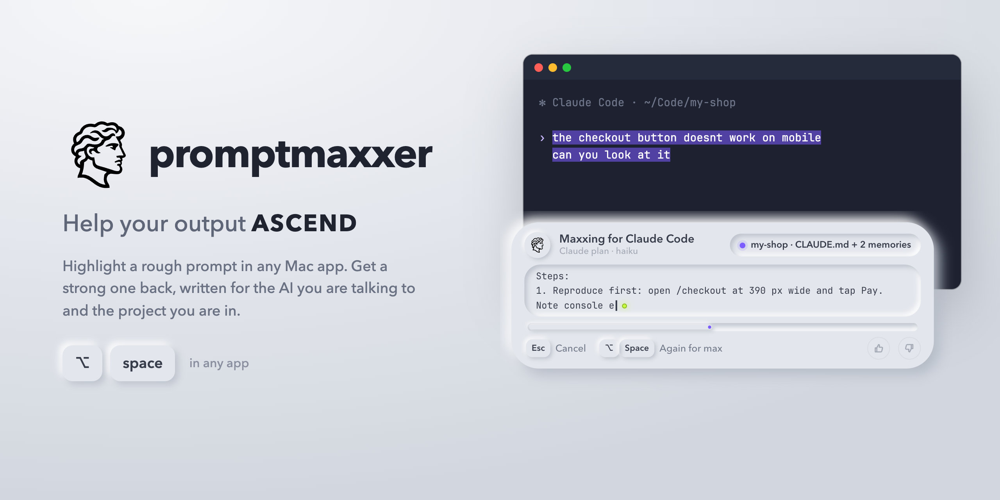
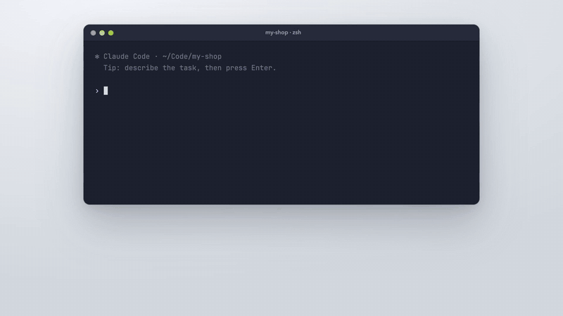
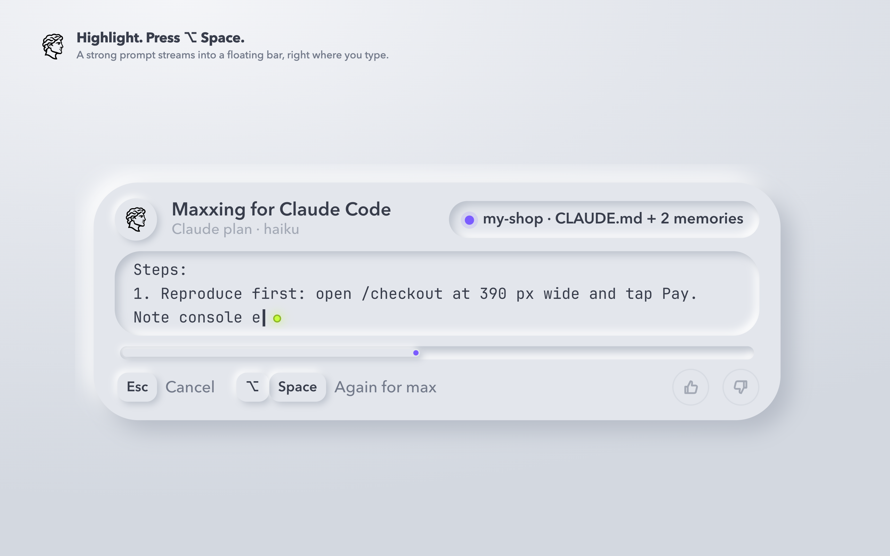
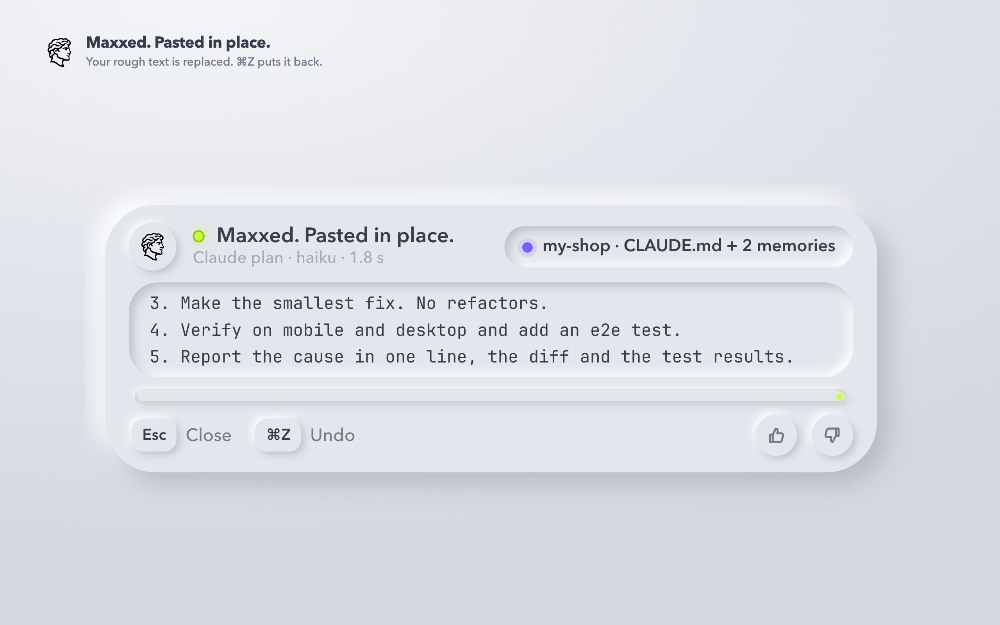
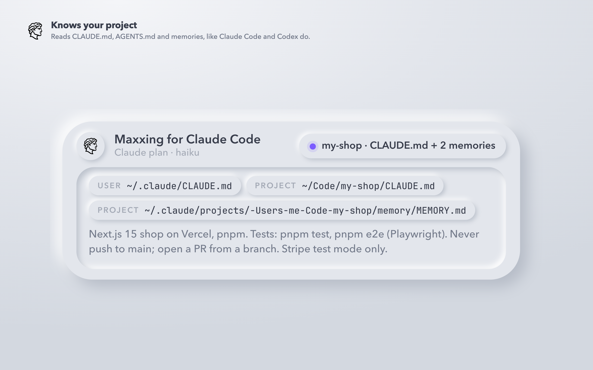
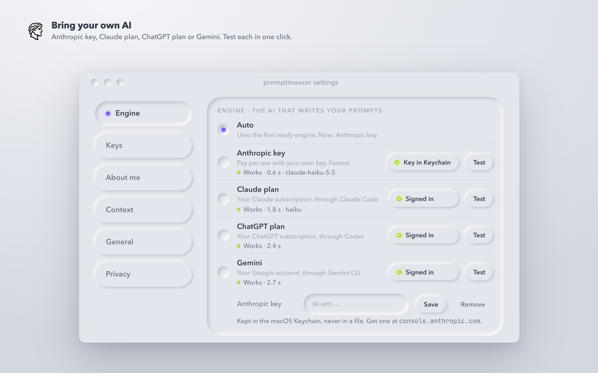
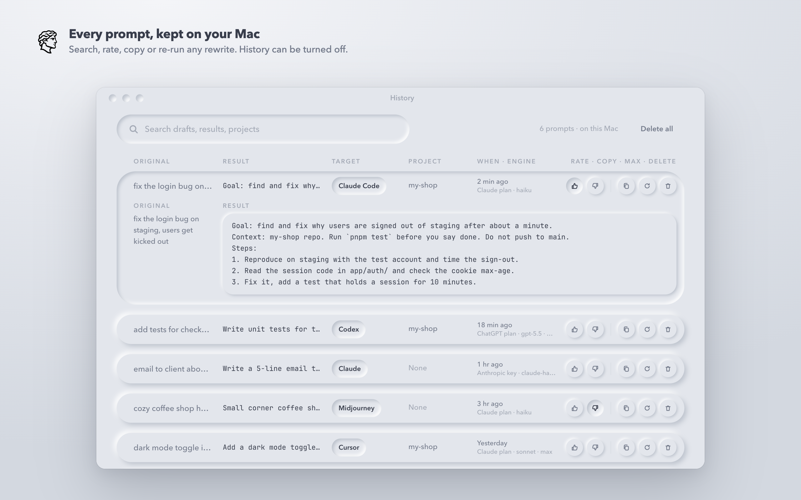
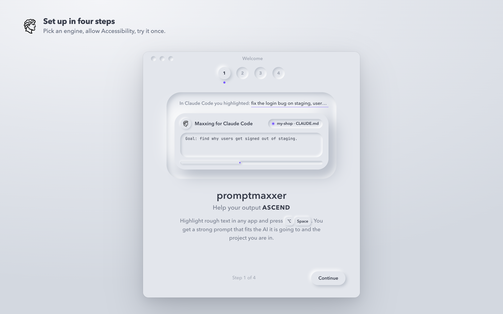

# promptmaxxer

<p align="center">
  
</p>

<p align="center">
  <a href="LICENSE"></a>
  
  
</p>

**Help your output ASCEND.**

promptmaxxer is a small macOS menu bar app. Highlight a rough prompt in any app, press **Option+Space**, and the
text is replaced with a strong prompt written for the AI it is going to and the project you are in.

<p align="center">
  
</p>

<p align="center"><a href="docs/media/promptmaxxer-demo.mp4"><b>▶ Watch the 35-second demo (MP4)</b></a></p>

## Features

- **Works in any app with editable text.** Notes, Mail, your browser, Claude, ChatGPT, VS Code, Cursor, Zed and more.
  In terminals (Terminal, iTerm2, Ghostty, Warp) the result goes to the clipboard instead, because a terminal
  cannot replace a selection.
- **Two keys.** Option+Space for a fast, compact rewrite. Ctrl+Shift+Space for a full brief with a stronger model.
  Press the fast key again while it runs to upgrade to max. Both keys can be changed in Settings.
- **Knows the target.** It reads the app in front and adapts the rewrite: a coding agent (Claude Code, Codex,
  Cursor), a chat assistant, a research tool, an image or video model.
- **Project memory, like Claude Code and Codex.** In a terminal or code editor it finds the project you are working
  in and reads the same instruction files those tools read (`CLAUDE.md`, `CLAUDE.local.md`, `AGENTS.md`,
  `.claude/CLAUDE.md`, and Claude Code's project memory). It turns them into a short project brief, so the rewrite
  uses your real commands, paths and rules.
- **Any model.** Use the AI plan you already pay for (a Claude plan through the Claude Code CLI, a ChatGPT plan
  through the Codex CLI), your own Anthropic API key, or any OpenAI-compatible API: OpenAI, OpenRouter, Groq,
  DeepSeek, Mistral, Gemini, or a local model through Ollama or LM Studio. Every model name can be changed.
- **Floating bar.** Shows the target, the context it used, and the prompt streaming in. Esc cancels.
- **Fail-safe.** Any error, timeout or refusal leaves your text unchanged and your clipboard restored.
- **Undo.** The paste is one edit: Cmd+Z in the app brings the original back.
- **Local history.** Search, copy, re-run as max, thumbs up or down, delete one or all, or turn history off.

## Screenshots

<table>
  <tr><td width="50%" align="center"><br><sub>The floating bar streams the new prompt</sub></td><td width="50%" align="center"><br><sub>Pasted in place, Cmd+Z puts it back</sub></td></tr>
  <tr><td width="50%" align="center"><br><sub>The project files it read</sub></td><td width="50%" align="center"><br><sub>Use your Claude plan, ChatGPT plan or API key</sub></td></tr>
  <tr><td width="50%" align="center"><br><sub>Local history with search and re-run</sub></td><td width="50%" align="center"><br><sub>Four-step setup</sub></td></tr>
</table>

## How it works

1. **Copy.** On the key press, promptmaxxer saves your clipboard, copies the selection, and notes the app in front.
2. **Context.** At the same time it works out the target AI from the app, and the project from the terminal's
   working folder or the editor's open folder (then up to the Git root).
3. **Project brief.** When the project's instruction files change (checked by fingerprint), it writes a brief of
   at most 300 words: stack, commands, rules, risky areas. Secrets are stripped from the files before they are
   summarised and again from the brief. Each rewrite reads only the cached brief.
4. **Rewrite.** The draft, the target and the brief go to the model with the rulebook in
   [`framework/system-prompt.md`](framework/system-prompt.md). The rulebook makes the model:
   find the real intent, classify the task and apply its playbook (coding agent, chat, research, writing, image or
   video, data, system prompt), scan for gaps (goal, context, constraints, output, done-criteria), pick a size that
   fits the task, write it, and check it before output. It never does the task itself.
5. **Guard.** If the reply is a comment or a refusal instead of a prompt, a check in code catches it and retries
   once with a firmer reminder. A second bad reply fails safely.
6. **Paste.** The result is pasted over the selection in the same app, and your old clipboard is put back.

### Engines

| Engine | Needs | Fast key | Max key |
|---|---|---|---|
| Any model (OpenAI-compatible API) | An API address and a model name; a key only if the service needs one (stored in the macOS Keychain) | your pick | your pick (empty: same as fast) |
| Anthropic API key | An API key from the Anthropic Console (stored in the macOS Keychain) | `claude-haiku-5-5` | `claude-sonnet-5-5` |
| Claude plan | [Claude Code](https://docs.claude.com/en/docs/claude-code) installed and signed in (`claude`) | `haiku` | `sonnet` |
| ChatGPT plan | [Codex CLI](https://github.com/openai/codex) installed and signed in (`codex`) | `gpt-6.2-sol` | `gpt-6.2-astra` |
| Google account (experimental) | Gemini CLI installed and signed in (`gemini`) | `flash` | `pro` |

The models in the table are the built-in ones. Settings > Engine > Model names replaces any of them with another
model name the engine accepts (for example `opus` for the Claude plan max key).

On Auto, the first ready engine in that order is used. "Any model" is ready only after you set it up, so setting it
up makes it the Auto pick. You can pin an engine per key in Settings; a pinned engine
that is not ready is never swapped for another one, so no other account is billed silently.

The CLI engines run in a scratch folder in your per-user temp folder, with your own `CLAUDE.md`/`AGENTS.md` and
memory turned off for the call. Claude Code runs with no tools; Codex runs read-only with its shell, web search and
other tools turned off. For Codex a scratch `CODEX_HOME` holds only a link to your sign-in file, so your global Codex
instructions and config are not loaded. Built-in model names live in `app/crates/pmx-engines/src/lib.rs`
(`EngineId::default_model`).

### Any model (OpenAI-compatible API)

Settings > Engine > Any model takes an API address, a fast model and an optional max model. `/chat/completions` is
added to the address. The list next to the address field has these:

| Service | API address | Key |
|---|---|---|
| Ollama on this Mac | `http://localhost:11434/v1` | none |
| LM Studio on this Mac | `http://localhost:1234/v1` | none |
| OpenRouter (hundreds of models) | `https://openrouter.ai/api/v1` | yes |
| OpenAI | `https://api.openai.com/v1` | yes |
| Google Gemini | `https://generativelanguage.googleapis.com/v1beta/openai` | yes |
| Groq, DeepSeek, Mistral, xAI, Together | see the list in Settings | yes |

Local models: the rulebook is about 6,000 tokens. Ollama's default context window can be smaller, and then it cuts
the start of the rulebook. Start Ollama with a bigger window, for example `OLLAMA_CONTEXT_LENGTH=16384 ollama serve`.
A model that is not loaded yet can take most of the 60-second limit on its first call. `<think>` blocks from
reasoning models are removed from the result.

## Requirements

- macOS 12 or later, or Windows 10/11 (see [Windows](#windows)).
- macOS: Accessibility permission (System Settings > Privacy & Security > Accessibility), so the app can copy and paste
  for you. The first-run screens walk you through it.
- At least one engine from the table above.

## Build and install

There is no signed download yet. Build it from source:

1. Install Rust (https://rustup.rs) and the Tauri CLI:
   ```sh
   cargo install tauri-cli --version "^2" --locked
   ```
2. Build:
   ```sh
   git clone <this repo> promptmaxxer
   cd promptmaxxer/app
   ./build.sh          # release app: src-tauri/target/release/bundle/macos/promptmaxxer.app
   ./build.sh dev      # debug binary only, faster
   ```
   A release build needs about 4 GB of disk for `target/` and a few GB of memory. On a machine with little memory,
   use `CARGO_BUILD_JOBS=2 ./build.sh`.
3. Install: copy `promptmaxxer.app` to `/Applications` and open it. Grant Accessibility when asked.

### Signing

`build.sh` signs with `APPLE_SIGNING_IDENTITY` if you set it, else ad-hoc (`-`). With ad-hoc signing every
build is a new app to macOS, so you have to grant Accessibility again after each rebuild. To avoid that, create a
self-signed code-signing certificate once (Keychain Access > Certificate Assistant > Create a Certificate,
type "Code Signing") and build with its name:

```sh
APPLE_SIGNING_IDENTITY="My Local Signing" ./build.sh
```

`security find-identity -p codesigning` lists the identities you have. To share builds with others you need an
Apple Developer ID and notarisation.

### Command line

The same binary can run one rewrite without any UI (no Accessibility needed):

```sh
echo "fix the login bug on mobile" | \
  /Applications/promptmaxxer.app/Contents/MacOS/promptmaxxer --rewrite --level standard --app Ghostty
```

Flags: `--level standard|max`, `--app NAME`, `--engine custom-api|anthropic-key|claude-plan|chatgpt-plan|gemini-plan`,
`--project DIR`, `--target HINT`, `--no-brief`. On failure it prints the draft unchanged and exits with code 1.

### Windows

Windows 10 and 11 are supported. CI (`.github/workflows/ci.yml`) builds an unsigned NSIS installer
(`promptmaxxer_<version>_x64-setup.exe`, per-user, no admin rights) on every push and keeps it as a build
artifact. To build it yourself on Windows, install Rust and the Tauri CLI as above, then in `app\src-tauri`:
`cargo tauri build --bundles nsis`. Windows shows a SmartScreen warning for an unsigned installer.

How it differs from macOS:

- Keys: `Ctrl+Alt+Space` (fast) and `Ctrl+Shift+Space` (max). `Alt+Space` is the Windows window menu.
- No Accessibility permission: the first-run screens skip that step.
- The menu bar icon is a system tray icon.
- API keys are stored in Windows Credential Manager (generic credentials `promptmaxxer:anthropic` and
  `promptmaxxer:custom-api`).
- Files: settings, history, briefs and the log are in `%APPDATA%\promptmaxxer`.
- Project context: Windows offers no clean way to read a terminal's working folder, so there is no automatic
  project brief. Pin a project in Settings to use one.
- The floating bar opens near the mouse, not under the selection.
- Terminals (Windows Terminal, PowerShell, Command Prompt, Git Bash) get the result on the clipboard. The copy in
  terminals and VS Code style editors uses `Ctrl+Insert`, which never interrupts a running program the way
  `Ctrl+C` does there.
- Apps running as administrator do not accept keys from a normal app (Windows UIPI): a press there copies nothing.
- CLI engines installed with npm (`claude.cmd`, `codex.cmd`, `gemini.cmd` in `%APPDATA%\npm`) are started through
  `node`, not `cmd.exe`.

`bin/promptmaxx` is the original Python prototype of the rewrite step (Claude Code CLI only). The eval harness uses
it as its reference runner.

## Tests and evals

```sh
# Rust, one crate at a time
(cd app/crates/pmx-context && cargo test)
(cd app/crates/pmx-engines && cargo test)
(cd app/src-tauri && cargo test)

# Python guard tests for bin/promptmaxx
python3 -I -m unittest discover -s tests

# Eval: rewrites 18 drafts with the framework and with a one-line baseline, judged blind by a stronger model.
# Needs the claude CLI, signed in. Uses your plan's usage.
python3 -I evals/run.py
```

Reports go to `evals/results/` (not tracked).

## Privacy

- No account, no server, no analytics, no tracking. The only network call is to the engine you picked
  (the API address you set, Anthropic directly, or the Claude Code, Codex or Gemini CLI on your Mac). With a local
  model (Ollama, LM Studio) nothing leaves your Mac.
- What is sent: the highlighted text, the app name and target, the cached project brief, and the rulebook.
  The highlighted text is sent as it is: do not highlight secrets. The project instruction files are scrubbed of
  keys and passwords before they are summarised, and the brief is scrubbed again.
- API keys are stored in the macOS login Keychain (service `promptmaxxer`, accounts `anthropic` and `custom-api`;
  on Windows: Credential Manager),
  never in a file or a log.
- Files on your Mac:
  - settings: `~/.local/share/promptmaxxer/settings.json`
  - history (drafts and results): `~/.local/share/promptmaxxer/history.jsonl`, file mode 600; turn it off in Settings
  - project briefs: `~/.local/share/promptmaxxer/briefs/`
  - log (no keys, no selected text): `~/Library/Logs/promptmaxxer.log`
  - Windows: all of these in `%APPDATA%\promptmaxxer` (log: `promptmaxxer.log`)
- The app never presses Enter or sends anything: it only replaces the text you highlighted.

## Repository layout

| Path | What |
|---|---|
| `app/src-tauri/` | The menu bar app (Tauri 2, Rust): keys, copy and paste, floating bar, settings, history |
| `app/crates/pmx-engines/` | Engines: any OpenAI-compatible API, Anthropic API, Claude Code CLI, Codex CLI, Gemini CLI; model choice; the output guard |
| `app/crates/pmx-context/` | Front app, target AI, project detection, instruction files, project brief, secret scrubbing |
| `app/ui/` | HTML, CSS and JS for the bar, settings, onboarding and history windows |
| `framework/system-prompt.md` | The rewrite rulebook |
| `evals/` | Eval harness and cases |
| `bin/promptmaxx`, `tests/` | Python prototype runner and its tests |
| `brand/` | Logo files and brand notes |
| `docs/SPEC.md` | The v1 product spec |
| `docs/RESOURCES.md` | Public prompt-engineering sources the rulebook draws on |

## License

Copyright (C) 2026 the promptmaxxer authors.

promptmaxxer is free software: you can redistribute it and/or modify it under the terms of the GNU Affero General
Public License as published by the Free Software Foundation, version 3. It is distributed WITHOUT ANY WARRANTY.
See [LICENSE](LICENSE) for the full text.
